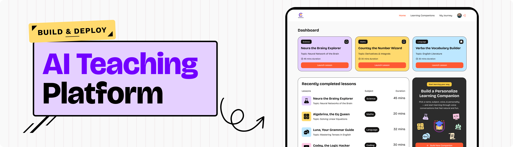

<div align="center">
  <br />
  
  <br />

  <div>
    
    
    
    
    
    
  </div>

  <h1 align="center">Converso — Real-Time AI Voice Learning Platform</h1>

  <p align="center">
    Platform SaaS Learning Management System (LMS) berbasis suara real-time di mana pengguna dapat membuat, mempersonalisasi, dan belajar bersama AI Voice Companion interaktif.
  </p>
</div>

---

## 📋 Daftar Isi

1. [Tentang Project](#-tentang-project)
2. [Tech Stack](#-tech-stack)
3. [Fitur Utama](#-fitur-utama)
4. [Struktur Project](#-struktur-project)
5. [Alur Sistem Pencarian & Filter](#-alur-sistem-pencarian--filter-search--filter-architecture)
6. [Instalasi & Setup Lokal](#-instalasi--setup-lokal)
7. [Database Schema (Supabase)](#-database-schema-supabase)
8. [Catatan Masalah & Solusi (Troubleshooting)](#-catatan-masalah--solusi-troubleshooting)

---

## 🚀 Tentang Project

**Converso** adalah aplikasi web SaaS modern yang memungkinkan pengguna membuat tutor AI kustom sesuai mata pelajaran (*Maths, Science, Coding, Language, History, Economics*), mengatur gaya bicara (*Formal / Casual*), serta berdiskusi langsung menggunakan suara secara *real-time* melalui integrasi **Vapi AI**, **Deepgram**, **ElevenLabs**, dan **OpenAI**.

---

## 🛠 Tech Stack

- **Framework:** [Next.js 16](https://nextjs.org/) (App Router, Server Actions, Turbopack)
- **Bahasa:** [TypeScript](https://www.typescriptlang.org/)
- **Autentikasi & Billing:** [Clerk](https://clerk.com/) (Auth, User Management, Subscription Plans & Feature Gating)
- **Database:** [Supabase](https://supabase.com/) (PostgreSQL)
- **Voice AI Agent:** [Vapi AI Web SDK](https://vapi.ai/) (Deepgram Transcriber + ElevenLabs Voice + GPT-4 Model)
- **Styling & UI:** [Tailwind CSS v4](https://tailwindcss.com/), [shadcn/ui](https://ui.shadcn.com/) (Base UI), [Lottie React](https://lottiereact.com/)
- **Form & Validasi:** React Hook Form + Zod
- **Monitoring:** [Sentry](https://sentry.io/)

---

## ✨ Fitur Utama

- 🎙️ **Real-Time AI Voice Sessions**: Belajar interaktif lewat percakapan suara dua arah dengan transkrip langsung (*live transcript*) dan animasi gelombang suara Lottie.
- 🛠️ **Custom Companion Builder**: Buat AI tutor sendiri dengan menentukan nama, mata pelajaran, topik spesifik, jenis suara (*male/female*), gaya mengajar (*formal/casual*), dan estimasi durasi.
- 💾 **Auto-Save Draft Form**: Ketikan di formulir pembuatan companion tersimpan otomatis di `localStorage` sehingga tidak hilang saat halaman tidak sengaja ter-refresh.
- 🔍 **Dynamic Search & Subject Filter**: Pencarian real-time dengan *debounce* dan filter mata pelajaran yang tersinkronisasi penuh dengan URL Query String.
- 🔖 **Bookmark System**: Simpan companion favorit ke daftar bookmark untuk diakses kembali kapan saja.
- 📊 **My Journey (User Profile Dashboard)**: Pantau jumlah sesi yang telah diselesaikan, jumlah companion yang dibuat, riwayat belajar terakhir, dan daftar bookmark.
- 💳 **Subscription & Plan Limits**: Pembatasan kuota pembuatan companion berdasarkan paket langganan pengguna (*Free, Core, Pro*) menggunakan Clerk Billing.

---

## 📁 Struktur Project

```bash
saas-app/
├── app/
│   ├── companions/
│   │   ├── [id]/page.tsx       # Halaman sesi belajar suara real-time (Vapi)
│   │   ├── new/page.tsx        # Halaman pembuatan AI Companion baru
│   │   └── page.tsx            # Katalog Companion Library + Search & Filter
│   ├── my-journey/page.tsx     # Dashboard profil, statistik, riwayat, & bookmark
│   ├── subscription/page.tsx   # Halaman tabel harga langganan Clerk
│   ├── sign-in/                # Halaman autentikasi Clerk
│   ├── globals.css             # Konfigurasi Tailwind v4 & custom utility classes
│   ├── layout.tsx              # Root layout dengan ClerkProvider & Navbar
│   └── page.tsx                # Halaman utama (Popular Companions, Recent Sessions, CTA)
├── components/
│   ├── ui/                     # Komponen dasar shadcn/ui (Button, Field, Select, Table, Accordion)
│   ├── CompanionCard.tsx       # Kartu informasi companion + tombol Bookmark
│   ├── CompanionComponent.tsx  # Kontrol sesi suara Vapi, mikrofon, & live transcript
│   ├── CompanionForm.tsx       # Form builder dengan React Hook Form, Zod, & localStorage draft
│   ├── CompanionsList.tsx      # Tabel daftar sesi & companion
│   ├── CTA.tsx                 # Banner Call-to-Action buat companion baru
│   ├── Navbar.tsx & NavItems.tsx
│   ├── SearchInput.tsx         # Input pencarian real-time berbasis URL query
│   └── SubjectFilter.tsx       # Dropdown filter kategori berbasis URL query
├── constants/                  # Data konstan (daftar mata pelajaran, kode warna, voice IDs)
├── lib/
│   ├── actions/
│   │   └── companion.actions.ts # Server Actions untuk CRUD Supabase & cek izin kuota Clerk
│   ├── supabase.admin.ts       # Klien Supabase Server/Admin
│   ├── utils.ts                # Helper warna & konfigurasi asisten Vapi AI
│   └── vapi.sdk.ts             # Inisialisasi SDK Vapi
└── supabase/
    └── schema.sql              # Script SQL pembuatan tabel & index Supabase
```

---

## 🔄 Alur Sistem Pencarian & Filter (Search & Filter Architecture)

Sistem pencarian dan filter berjalan seperti rantai estafet melalui 3 bagian utama:

```text
[User Input: Search/Filter] 
        ⬇
[1. URL Query String di Browser] (topic & subject)
        ⬇
[2. Server Page (app/companions/page.tsx)] (baca searchParams)
        ⬇
[3. Server Action (lib/actions/companion.actions.ts)] (query ke database)
        ⬇
[Database Supabase] ➔ [UI Cards Terupdate]
```

### 1. Penulis URL (Frontend Client Components)
Bertugas menangkap input user dan memperbarui URL tanpa reload halaman:
- **`components/SearchInput.tsx`**: Mengisi parameter `topic` saat user mengetik kata kunci materi/pelajaran (dilengkapi *debounce* 500ms).
- **`components/SubjectFilter.tsx`**: Mengisi parameter `subject` saat user memilih kategori mata pelajaran.
- **Catatan**: Helper `formUrlQuery` dan `removeKeysFromUrlQuery` dari `@jsmastery/utils` digunakan agar parameter `subject` & `topic` bisa digabung tanpa saling menimpa.

### 2. Perantara Pembaca URL (Server Component Page)
- **`app/companions/page.tsx`**: Menangkap parameter query dari URL browser via `searchParams`, lalu mengopernya ke fungsi backend:
  ```tsx
  const CompanionsLibrary = async ({ searchParams }: SearchParams) => {
    const filters = await searchParams;
    const subject = filters.subject ? filters.subject : "";
    const topic = filters.topic ? filters.topic : "";

    const companions = await getAllCompanions({ subject, topic });
    // ...
  }
  ```

### 3. Eksekutor Database (Server Action / Backend)
- **`lib/actions/companion.actions.ts` (`getAllCompanions`)**: Memfilter data secara dinamis di database Supabase menggunakan operator case-insensitive `ilike`:
  ```tsx
  if (subject && topic) {
    query = query
      .ilike("subject", `%${subject}%`)
      .or(`topic.ilike.%${topic}%,name.ilike.%${topic}%`);
  } else if (subject) {
    query = query.ilike("subject", `%${subject}%`);
  } else if (topic) {
    query = query.or(`topic.ilike.%${topic}%,name.ilike.%${topic}%`);
  }
  ```

---

## ⚙️ Instalasi & Setup Lokal

### 1. Prasyarat
Pastikan di komputer kamu sudah terpasang:
- [Node.js](https://nodejs.org/) (v20.9.0+) atau [Bun](https://bun.sh/)
- Akun [Clerk](https://clerk.com/), [Supabase](https://supabase.com/), dan [Vapi AI](https://vapi.ai/)

### 2. Clone & Install Dependencies

```bash
git clone <url-repo-kamu>
cd saas-app
bun install
```

### 3. Konfigurasi Environment Variables
Buat file `.env.local` di root project dan isi variabel berikut:

```env
# Clerk Authentication
NEXT_PUBLIC_CLERK_PUBLISHABLE_KEY=pk_test_...
CLERK_SECRET_KEY=sk_test_...
NEXT_PUBLIC_CLERK_SIGN_IN_URL=/sign-in
NEXT_PUBLIC_CLERK_SIGN_IN_FALLBACK_REDIRECT_URL=/
NEXT_PUBLIC_CLERK_SIGN_UP_FALLBACK_REDIRECT_URL=/

# Supabase Database
NEXT_PUBLIC_SUPABASE_URL=https://your-project.supabase.co
NEXT_PUBLIC_SUPABASE_PUBLISHABLE_KEY=eyJhbG...
SUPABASE_SERVICE_ROLE_KEY=eyJhbG...

# Vapi Voice AI
NEXT_PUBLIC_VAPI_WEB_TOKEN=your_vapi_public_token

# Sentry (Opsional)
SENTRY_AUTH_TOKEN=sntrys_...
```

### 4. Jalankan Development Server

```bash
bun dev
```
Buka [http://localhost:3000](http://localhost:3000) di browser.

---

## 🗄️ Database Schema (Supabase)

Buka menu **SQL Editor** di Dashboard Supabase kamu, lalu jalankan isi file [`supabase/schema.sql`](supabase/schema.sql):

```sql
-- 1. Tabel companions
create table if not exists public.companions (
  id uuid default gen_random_uuid() primary key,
  name text not null,
  subject text not null,
  topic text not null,
  voice text not null,
  style text not null,
  duration integer not null,
  author text not null,
  created_at timestamp with time zone default timezone('utc'::text, now()) not null
);

-- 2. Tabel session_history
create table if not exists public.session_history (
  id uuid default gen_random_uuid() primary key,
  companion_id uuid references public.companions(id) on delete cascade not null,
  user_id text not null,
  created_at timestamp with time zone default timezone('utc'::text, now()) not null
);

-- 3. Tabel bookmarks
create table if not exists public.bookmarks (
  id uuid default gen_random_uuid() primary key,
  companion_id uuid references public.companions(id) on delete cascade not null,
  user_id text not null,
  created_at timestamp with time zone default timezone('utc'::text, now()) not null,
  constraint unique_user_companion unique (user_id, companion_id)
);
```

---

## 🛠️ Catatan Masalah & Solusi (Troubleshooting)

### 1. Error Vapi: `Call object is not available` pada Toggle Microphone
- **Gejala**: Saat tombol mikrofon diklik sebelum sesi panggilan dimulai, muncul runtime error `Call object is not available` pada baris `vapi.setMuted(!isMuted)`.
- **Penyebab**: Vapi belum membentuk koneksi sesi audio (Daily WebRTC call object belum ada) sebelum `vapi.start()` berhasil dijalankan dan status menjadi `ACTIVE`.
- **Solusi**:
  1. Berikan *guard clause* di fungsi `toggleMicrophone`:
     ```typescript
     const toggleMicrophone = () => {
       if (callStatus !== CallStatus.ACTIVE) return;
       const isMuted = vapi.isMuted();
       vapi.setMuted(!isMuted);
       setIsMuted(!isMuted);
     };
     ```
  2. Nonaktifkan atribut tombol mikrofon saat sesi belum aktif (`disabled={callStatus !== CallStatus.ACTIVE}`).

### 2. Next.js 16 Blocking Route Error (`cacheComponents: true`)
- **Gejala**: Muncul error *Route encountered runtime/uncached data during prerendering* saat memakai `await auth()`, `currentUser()`, atau query Supabase langsung di Server Component.
- **Solusi**:
  - Gunakan `<Suspense>` untuk membungkus komponen yang melakukan data fetching di halaman publik (seperti di `app/page.tsx`).
  - Atau tambahkan `export const instant = false;` pada rute privat/dinamis (seperti `/companions/new`, `/companions`, dan `/my-journey`).

### 3. Clerk v7 (Core 3): `<SignedIn>` & `<SignedOut>` Deprecated / Unavailable
- **Gejala**: Runtime error `Clerk: <SignedOut> is not available in @clerk/nextjs Core 3` atau terjadi *Hydration Mismatch* pada auth header.
- **Penyebab**: Di `@clerk/nextjs` v7+, komponen otentikasi lama digantikan oleh komponen terpadu `<Show>`.
- **Solusi**:
  Gunakan `<Show>` yang dibungkus `<Suspense>` dengan fallback skeleton di `Navbar.tsx`:
  ```tsx
  <Suspense fallback={<div className="size-8 rounded-full bg-muted animate-pulse" />}>
    <Show when="signed-out">
      <SignInButton>
        <button className="btn-signin">Sign In</button>
      </SignInButton>
    </Show>
    <Show when="signed-in">
      <UserButton />
    </Show>
  </Suspense>
  ```

### 4. Responsif Skala UI (90% Base Zoom)
- **Problem**: Pada zoom normal 100%, elemen card dan CTA bisa terlihat terlalu besar atau memakan banyak ruang vertikal.
- **Solusi**:
  Atur ukuran font dasar `html` ke `90%` di `app/globals.css`. Karena seluruh layout Tailwind CSS menggunakan satuan `rem`, seluruh proporsi teks, kartu, dan komponen UI otomatis mengecil secara proporsional dan rapi:
  ```css
  @layer base {
    html {
      font-size: 90%;
    }
  }
  ```
